# Prudhvi Krovvidi

I build AI applications and tools that make complex work easier.

Data Scientist at Gramener, based in Hyderabad. My work spans LLM applications,
data engineering, and reusable tooling for AI agents.

[Portfolio](https://prudhvi1709.github.io/) / [LinkedIn](https://www.linkedin.com/in/prudhvi-krovvidi/) / [Email](mailto:kprudhvi71@gmail.com)

<picture>
  <source media="(prefers-color-scheme: dark)" srcset="assets/ai-workshop-dark.svg">
  <source media="(prefers-color-scheme: light)" srcset="assets/ai-workshop-light.svg">
  
</picture>

## Selected work

### [Agents Toolkit](https://github.com/prudhvi1709/agents-toolkit)

Reusable skills, hooks, and scripts for coding and non-coding AI agents.
Shared workflows for Claude and Codex, with local context retrieval and
verification tools.

**Agent tooling / Python / Claude / Codex**

[Browse the toolkit](https://github.com/prudhvi1709/agents-toolkit)

### [Talks and workshops](https://github.com/prudhvi1709/talks)

Slides, recordings, and supporting examples on applied AI, evaluation,
LLM-powered data engineering, and working with AI as a co-developer.
Includes "Good Enough for What?" at The Fifth Elephant.

**AI evaluation / Applied AI / Developer workflows / Teaching**

[Browse the talks](https://prudhvi1709.github.io/talks/)

### [Dailynews](https://github.com/prudhvi1709/dailynews)

A scheduled AI-news workflow that collects articles from RSS feeds, ranks
relevant stories, generates a digest with LLM assistance, and delivers it
by email. Includes a public digest archive.

**Workflow automation / Python / RSS / GitHub Actions**

[Explore the code](https://github.com/prudhvi1709/dailynews) / [Browse the digest](https://prudhvi1709.github.io/dailynews/)

Also explore: [VideoAlert](https://github.com/prudhvi1709/videoalert), a
multimodal anomaly-detection demo; and [Jailbreak Arena](https://github.com/prudhvi1709/jailbreak),
a prompt-hacking game.

## How I approach the work

- Start with the user's task and the data behind it.
- Make the result inspectable, with clear assumptions and useful checks.
- Turn repeatable work into tools that other people can use.

## Beyond the repositories

My [portfolio](https://prudhvi1709.github.io/) brings together project case studies
and research in deep learning and blockchain.

Off the clock: motorcycles, strength training, and coffee.

About the workshop illustration

A visual metaphor for building and checking useful tools, not a diagram of a
specific system. Generated SVGs adapt the MIT-licensed
[Anatomy](https://github.com/wheresryan22/anatomy) drawing kit by Ryan.
The generator is in `scripts/build-workshop.mjs`; rebuild with
`node scripts/build-workshop.mjs`.

