Off the clock - show / hide

  <picture>
    <source media="(prefers-reduced-motion: reduce) and (max-width: 600px)" srcset="assets/particle-identity-mobile-still.svg">
    <source media="(prefers-reduced-motion: reduce)" srcset="assets/particle-identity-still.svg">
    <source media="(max-width: 600px)" srcset="assets/particle-identity-mobile.svg">
    
  </picture>

  <b>Data Scientist at Gramener. Based in Hyderabad.</b> 
  LLM applications, data engineering, and tools for AI agents.

  <a href="https://prudhvi1709.github.io/"><b>Explore my portfolio</b></a>
  /
  <a href="https://www.linkedin.com/in/prudhvi-krovvidi/">LinkedIn</a>
  /
  <a href="mailto:kprudhvi71@gmail.com">Email</a>

# Built, shared, and automated

<a href="https://github.com/prudhvi1709/agents-toolkit">
  <picture>
    <source media="(max-width: 600px)" srcset="assets/agents-toolkit-mobile.svg">
    
  </picture>
</a>

Open the agent workbench

<picture>
  <source media="(prefers-reduced-motion: reduce) and (max-width: 600px)" srcset="assets/agent-workflow-mobile-still.svg">
  <source media="(prefers-reduced-motion: reduce)" srcset="assets/agent-workflow-still.svg">
  <source media="(max-width: 600px)" srcset="assets/agent-workflow-mobile.svg">
  
</picture>

<a href="https://prudhvi1709.github.io/talks/">
  <picture>
    <source media="(max-width: 600px)" srcset="assets/talks-mobile.svg">
    
  </picture>
</a>

Follow a talk from question to shared ideas

<picture>
  <source media="(prefers-reduced-motion: reduce) and (max-width: 600px)" srcset="assets/talk-workflow-mobile-still.svg">
  <source media="(prefers-reduced-motion: reduce)" srcset="assets/talk-workflow-still.svg">
  <source media="(max-width: 600px)" srcset="assets/talk-workflow-mobile.svg">
  
</picture>

<a href="https://prudhvi1709.github.io/dailynews/">
  <picture>
    <source media="(max-width: 600px)" srcset="assets/dailynews-mobile.svg">
    
  </picture>
</a>

Follow the news publishing flow

<picture>
  <source media="(prefers-reduced-motion: reduce) and (max-width: 600px)" srcset="assets/news-workflow-mobile-still.svg">
  <source media="(prefers-reduced-motion: reduce)" srcset="assets/news-workflow-still.svg">
  <source media="(max-width: 600px)" srcset="assets/news-workflow-mobile.svg">
  
</picture>

[Agents Toolkit source](https://github.com/prudhvi1709/agents-toolkit) / [Talks source](https://github.com/prudhvi1709/talks) / [Dailynews source](https://github.com/prudhvi1709/dailynews)

## More experiments

[**VideoAlert**](https://github.com/prudhvi1709/videoalert) - A multimodal anomaly-detection demo. 
[**Jailbreak Arena**](https://github.com/prudhvi1709/jailbreak) - A prompt-hacking game.

---

KTM Duke 390. Black coffee. A background in powerlifting.

About the visuals

All visuals in this README are self-contained SVGs, with no JPG or PNG assets.
The opening is a personal point-cloud reveal. Each project has its own
click-to-reveal walkthrough, so it plays when opened. Reduced-motion settings
select still overviews. The personal reveal loops every 10 seconds, with a hold
on the finished name; use its show/hide control to hide it. Project illustrations
and walkthroughs play once and settle.

The agent-tool illustration adapts Ryan's MIT-licensed
[Anatomy](https://github.com/wheresryan22/anatomy) kit.

Rebuild with `node scripts/build-profile.mjs`, `node scripts/build-particles.mjs`,
and `node scripts/build-workflows.mjs`.
See [visual notes](docs/visual-direction.md) for sources and design decisions.

